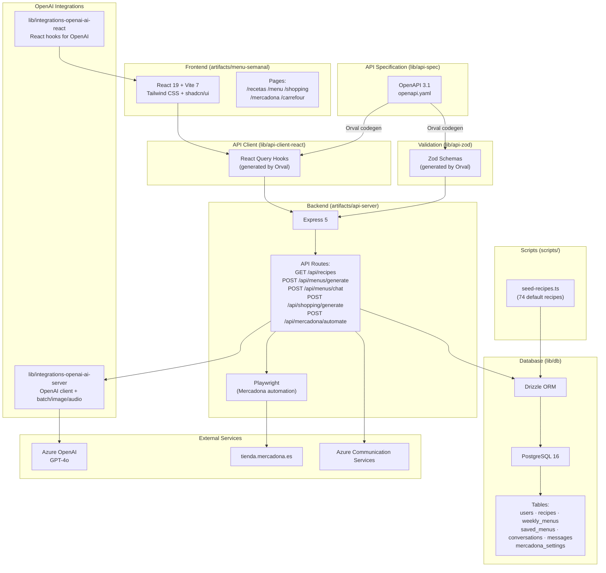

# La Cocina — Weekly Menu Planner

A full-stack web application for weekly meal planning powered by a conversational AI agent, personal recipe management, automated shopping list generation, and Mercadona grocery cart automation.

## Features

- **Recipe Management** — Browse and manage personal recipes organized by type (first course, second course, other). New users are seeded with 74 default recipes.
- **AI Menu Generation** — Generate weekly menus using Azure OpenAI GPT-4o. The AI respects historical preferences (5 weeks of learning), parses natural-language constraints (e.g. "no fish at lunch", "only seconds"), and enforces them programmatically as a safeguard.
- **Conversational Menu Editing** — Refine and modify menus incrementally through a chat interface with full context awareness. The AI assistant only changes what you ask for.
- **Drag & Drop** — Visually rearrange meals across days and slots.
- **Shopping List** — Auto-consolidated ingredient list generated from the active menu, grouped by normalized ingredient with recipe attribution.
- **WhatsApp Shopping** — Link a phone and send text commands to add ingredients to the same shopping list, with durable processing and WhatsApp confirmations (requires Meta WhatsApp Business Cloud API configuration).
- **Supermarket Search** — Open every shopping-list ingredient directly in Mercadona or Carrefour.
- **Mercadona Automatic Cart** — Learns from your own Mercadona orders which product and how many units you buy for each ingredient, and fills your Mercadona cart with this week's menu in one click. You always review the cart and checkout yourself.
- **PDF Export** — Export menus as A4 landscape table-format PDFs using a custom pure-Node generator (no external dependencies).
- **Email** — Send menus via Azure Communication Services with PDF attachments. Includes welcome emails on registration.
- **Multi-User** — Per-user recipes, menus, AI settings, and credentials. Password authentication with email-based reset tokens.

## Mercadona automatic cart

Open **Mercadona** (or **Lista de Compra → Cesta de Mercadona**), confirm your Mi
Cocina password once and drag the **Mi Cocina → Mercadona** bookmark to the
bookmarks bar. With your session open on tienda.mercadona.es, click it:

1. It reads the delivered orders Mi Cocina has not seen yet (last 12 months, at
   most 40 per run, a few seconds apart so Mercadona does not block the session).
2. Every ingredient of every dish of your weekly menu goes to the cart. Your
   history only decides the product and the amount: the server pairs every
   saved weekly menu (and the menu of every cart it computed, since generating
   a new menu replaces the previous one) with the order delivered up to five
   days later, picks the product you bought for that ingredient and multiplies
   what you bought per dish by this week's dishes (at most twice your largest
   purchase). Ingredients you never bought are searched in Mercadona's
   catalogue, preferring products you have bought before; ingredients you rarely
   buy with those dishes are added with a "check if you already have it" note.
3. Products are added to the Mercadona cart. Products already in the cart keep
   the larger quantity (nothing is summed twice); unavailable products are
   replaced by the closest available one. Nothing is ordered or paid: review the
   cart and use **Añadir al pedido en curso** or **Tramitar nuevo pedido**.

The bookmark runs inside your own Mercadona session, so Mercadona credentials
never reach Mi Cocina. It carries a per-device connector token (stored hashed;
up to five per user) that is required to read or write purchase history.
**Desconectar** revokes every token and **Borrar historial** deletes the stored
orders and plans. The algorithm lives in
`artifacts/api-server/src/lib/mercadona-planner.ts`
(`pnpm --filter @workspace/api-server run test:mercadona`).

## WhatsApp → shopping list

WhatsApp adds ingredients **to the existing shopping list**, not to Mercadona's
cart. This first version accepts explicit Spanish text commands, not an
unrestricted AI conversation or voice notes:

- `añade leche, huevos y pan`
- `añade a la lista de la compra 2 kg de tomates`
- `lista: leche; aceite; arroz`
- `ayuda` (or an unsupported message) returns usage instructions without changes.

Use commas, semicolons, newlines or ` y ` to separate ingredients. Quantities
remain part of the ingredient text; they are not converted or summed. Limit:
20 ingredients, 120 characters each, 2,000 characters per message. A comma between
digits is preserved as a decimal separator.

### Activation

1. Configure a Meta developer app with WhatsApp Business Cloud API and a business
   phone number. During testing, authorize the recipient number in Meta.
2. Set these **server-only** environment variables using your hosting platform's
   secret settings (never `VITE_*`, Git, or browser storage):

   | Variable | Value |
   |----------|-------|
   | `WHATSAPP_APP_SECRET` | Meta app secret used to verify webhook signatures |
   | `WHATSAPP_VERIFY_TOKEN` | A random secret chosen by you for webhook verification |
   | `WHATSAPP_ACCESS_TOKEN` | Meta token with `whatsapp_business_messaging` permission |
   | `WHATSAPP_PHONE_NUMBER_ID` | Meta phone-number ID, not the visible phone number |
   | `WHATSAPP_BUSINESS_NUMBER` | Business number with country code, digits only |
   | `WHATSAPP_GRAPH_VERSION` | Supported version enabled for your Meta app, e.g. `v23.0` |

3. Deploy the backend to a public HTTPS URL. Set Meta's callback URL to
   `https://YOUR_API_HOST/api/whatsapp/webhook`, enter the same verification token,
   and subscribe to the WhatsApp **messages** webhook field.
4. In **Lista de Compra → Añadir desde WhatsApp**, enter your account password,
   generate a code, open WhatsApp and **send** the prepared `vincular ...` message.
   The one-use code expires after 10 minutes. Never share it.
5. After receiving the linking confirmation, send `añade leche y huevos`.
   The ingredients appear alongside recipe ingredients, labelled **WhatsApp**.
   The open shopping page refreshes every 10 seconds.

The panel explicitly shows pending activation if configuration is missing.
Credentials and a real Meta number are not provisioned by this code change.
No message or credential is sent to Meta during automated tests.

### Persistence and behavior

- Tables are initialized idempotently at API startup: `whatsapp_links`,
  `whatsapp_ingredients`, `whatsapp_messages`.
- Ingredients belong to the linked user, not to a particular menu. They survive
  menu regeneration and remain until removed with the item's **X** button.
  They also work before the user has created a menu.
- Existing shopping GET/generate responses merge these ingredients with recipes.
  Identical normalized names appear once with both recipe and WhatsApp attribution.
  Removing a WhatsApp addition does not remove an ingredient still needed by a recipe.
  Existing manual extras in browser storage are unchanged.
- Shopping email snapshots and Mercadona **search links** receive the same merged
  list. WhatsApp never changes a Mercadona cart or submits an order.
- One phone can link to one account. Link/unlink requires the account password in
  addition to the app's existing `X-User-Id` identification; link attempts are limited
  per user per server process. Unlinking revokes future phone writes but does not
  remove already-added ingredients.
- POST webhooks require an HMAC-SHA256 signature over the raw body and the configured
  receiving phone-number ID. A 200 response is sent only after durable insertion;
  database outages return 503 so Meta can retry. Status callbacks are ignored.
- Incoming message IDs are unique. Ingredient writes and their acknowledgement are
  committed in one transaction. Repeated webhooks, concurrent workers, restarts and
  reply retries do not repeat a completed ingredient write.
- Reply delivery retries up to five processing attempts, within 23 hours of receipt.
  A timeout after Meta accepts a reply can repeat the **confirmation**, never the
  ingredients. Exhausted jobs remain in `failed`; operators can inspect queue state
  in PostgreSQL. Actual end-user delivery/read receipts are not tracked.
- Successful command processing clears the stored incoming text. Phone numbers and
  replies remain in the queue: restrict database access and define a retention policy
  appropriate to your deployment. Keep message-ID tombstones when purging sensitive
  content so historical webhook retries cannot repeat actions.

### API and tests

Account endpoints use `X-User-Id`:

| Method | Path | Contract |
|--------|------|----------|
| GET | `/api/whatsapp/status` | `{ configured, phone: maskedPhoneOrNull, chatUrl }` |
| POST | `/api/whatsapp/link` | `{ password }` → `{ code, url, expiresInSeconds: 600 }` |
| POST | `/api/whatsapp/unlink` | `{ password }` → `{ success: true }` |
| GET | `/api/whatsapp/ingredients` | `[{ id, ingredient }]` for the current user |
| DELETE | `/api/whatsapp/ingredients/:id` | Remove own addition; 204 or 404 |
| GET | `/api/shopping-list/0` | WhatsApp ingredients without a menu, same shopping response shape |

Run `pnpm --filter @workspace/api-server test:whatsapp` for unit tests.
To include HTTP/PostgreSQL integration tests, set `WHATSAPP_TEST_DATABASE_URL` to
an **isolated local database named `whatsapp_test`**. Integration tests erase the
test tables and never use the application's ordinary `DATABASE_URL`.

## GitHub Pages API configuration

The Pages build reads the repository secret `API_URL` into `VITE_API_URL`.
For the current production backend, its value is
`https://micocina.azurewebsites.net` (not the obsolete
`https://menu-planner-api.azurewebsites.net`). This public URL is embedded at
build time, so changing the secret requires a new **Deploy to GitHub Pages** run.

Before publishing, `scripts/check-public-api.mjs` checks database-backed health,
CORS for the Pages origin and the public login validation contract using an
empty request. It sends no passwords and changes no accounts. A failed check
stops deployment rather than replacing the live frontend with a broken build.
Run its tests with `node --test scripts/check-public-api.test.mjs`.

## Tech Stack

| Layer | Technologies |
|-------|-------------|
| **Frontend** | React 19, Vite 7, Tailwind CSS 4, shadcn/ui (Radix UI), Framer Motion, React Query, Wouter |
| **Backend** | Express 5, Node.js, Pino (logging), Helmet |
| **Database** | PostgreSQL 16, Drizzle ORM |
| **AI** | Azure OpenAI GPT-4o via `@azure/identity` (Entra ID / Managed Identity) |
| **Validation** | Zod, Drizzle-Zod |
| **API** | OpenAPI 3.1, Orval (code generation) |
| **Automation** | Playwright + puppeteer-extra-plugin-stealth (Mercadona) |
| **Email** | Azure Communication Services |
| **Monorepo** | pnpm workspaces, TypeScript 5.9 (composite projects) |
| **Deployment** | Docker (multi-stage), Render.com, Azure App Service / Container Apps |

## Architecture



## Monorepo Structure

```
menu-planner/
├── artifacts/                          # Deployable applications
│   ├── api-server/                     # Express 5 API server
│   ├── menu-semanal/                   # React + Vite frontend
│   └── mockup-sandbox/                 # UI component sandbox
├── lib/                                # Shared libraries
│   ├── api-spec/                       # OpenAPI 3.1 spec + Orval config
│   ├── api-client-react/               # Generated React Query hooks
│   ├── api-zod/                        # Generated Zod schemas
│   ├── db/                             # Database layer (Drizzle ORM)
│   ├── integrations-openai-ai-server/  # OpenAI integration (server)
│   └── integrations-openai-ai-react/   # OpenAI integration (React)
├── scripts/                            # Utility scripts
├── pnpm-workspace.yaml                 # Workspace configuration
├── tsconfig.base.json                  # Shared TS options
└── tsconfig.json                       # Project references
```

## Packages

### `artifacts/api-server`

Express 5 API server. Routes use `@workspace/api-zod` for validation and `@workspace/db` for persistence.

- **Entry**: `src/index.ts` — reads `PORT`, runs auto-migration, seeds initial data, starts the server
- **Routes**: mounted at `/api` (health, users, recipes, menus, shopping, mercadona, email, ai-chat, saved-menus)
- **Auth**: `X-User-Id` header-based authentication with user lookup
- **Build**: esbuild bundles to CJS (`dist/index.cjs`)

### `artifacts/menu-semanal`

React + Vite frontend with shadcn/ui and Tailwind CSS.

- **Pages**: Recipes, Weekly Menu, Shopping List, Mercadona, Carrefour
- **Data**: React Query with hooks generated from `@workspace/api-client-react`
- **Interaction**: Drag & drop menu editing, conversational AI chat

From **Lista de Compra**, choose **Cesta de Mercadona** or **Buscar en Carrefour**.
Both pages include menu ingredients and manual additions. Each ingredient opens
the supermarket's search in a new tab; choose products and complete checkout on
the supermarket website. The Mercadona page also offers the automatic cart
described above; neither page stores supermarket credentials. Both supermarkets
are also available in the desktop and mobile navigation.

### `lib/api-spec`

OpenAPI 3.1 specification (`openapi.yaml`) and Orval configuration. Code generation produces:
- React Query hooks → `lib/api-client-react/src/generated/`
- Zod schemas → `lib/api-zod/src/generated/`

### `lib/db`

Database layer with Drizzle ORM and PostgreSQL.

**Tables**:
| Table | Description |
|-------|-------------|
| `users` | User profiles with auth, avatar, and per-user Azure OpenAI settings |
| `password_reset_tokens` | Time-limited password reset tokens |
| `recipes` | Recipes with name, category (primero/segundo/otro), ingredients, and instructions |
| `weekly_menus` | AI-generated weekly menus (JSONB: 7 days × lunch/dinner with 4 slots each) |
| `saved_menus` | Archived/saved menus with labels |
| `conversations` | Chat conversation history |
| `messages` | Individual chat messages |
| `mercadona_settings` | Legacy Mercadona credentials and session tokens (unused by the UI) |
| `mercadona_connectors` | Hashed per-device tokens of the Mercadona bookmark |
| `mercadona_orders` | Delivered Mercadona orders (lines with product and quantity) used to learn habits |
| `mercadona_cart_plans` | Recent computed carts and what was added to Mercadona |
| `mercadona_menu_snapshots` | Recipes of each menu a cart was computed for, paired later with the order |

### `lib/integrations-openai-ai-server`

Server-side OpenAI integration utilities: client, batch processing, image generation, and audio processing.

### `lib/integrations-openai-ai-react`

React hooks for OpenAI integration, including audio hooks.

## API

| Method | Route | Description |
|--------|-------|-------------|
| `GET` | `/api/health` | Health check |
| `GET` | `/api/recipes` | List recipes (filter by category) |
| `POST` | `/api/recipes` | Create recipe |
| `GET` | `/api/recipes/:id` | Get recipe by ID |
| `PUT` | `/api/recipes/:id` | Update recipe |
| `DELETE` | `/api/recipes/:id` | Delete recipe |
| `POST` | `/api/menus/generate` | Generate weekly menu with AI |
| `POST` | `/api/menus/chat` | Conversational chat to edit menu |
| `GET` | `/api/menus` | List user menus |
| `GET` | `/api/menus/:id` | Get specific menu |
| `PATCH` | `/api/menus/:id` | Update menu days (drag & drop) |
| `DELETE` | `/api/menus/:id` | Delete menu |
| `POST` | `/api/shopping-list/generate` | Generate shopping list from menu |
| `GET` | `/api/shopping-list/:menuId` | Get shopping list |
| `GET` | `/api/mercadona/credentials` | Check Mercadona credentials |
| `POST` | `/api/mercadona/credentials` | Save credentials |
| `DELETE` | `/api/mercadona/credentials` | Delete credentials |
| `POST` | `/api/mercadona/automate` | Legacy server-side Mercadona automation |
| `POST` | `/api/mercadona/connector` | Create a bookmark token (requires the account password) |
| `GET` | `/api/mercadona-connector/status` | History summary and latest cart (Bearer connector token) |
| `GET` | `/api/mercadona-connector/state` | Order ids already synchronized (bookmark) |
| `POST` | `/api/mercadona-connector/orders` | Store delivered orders read by the bookmark |
| `POST` | `/api/mercadona-connector/plan` | Compute the cart for the current menu |
| `POST` | `/api/mercadona-connector/plan/:id/result` | Record what was added to the Mercadona cart |
| `DELETE` | `/api/mercadona-connector/history` | Delete stored orders and carts |
| `POST` | `/api/mercadona-connector/disconnect` | Revoke every bookmark token |
| `POST` | `/api/saved-menus` | Save/archive a menu |
| `GET` | `/api/saved-menus` | List saved menus |
| `GET` | `/api/saved-menus/:id/pdf` | Export saved menu as PDF |
| `POST` | `/api/email/send-menu` | Send menu via email with PDF |
| `POST` | `/api/users/login` | Login |
| `POST` | `/api/users/register` | Register new user |

## Development

### Prerequisites

- Node.js 24
- pnpm
- PostgreSQL 16

### Setup

```bash
pnpm install
```

### Commands

```bash
# Full monorepo typecheck
pnpm run typecheck

# Production build
pnpm run build

# API server (dev)
pnpm --filter @workspace/api-server run dev

# Frontend (dev)
pnpm --filter @workspace/menu-semanal run dev

# Generate code from OpenAPI spec
pnpm --filter @workspace/api-spec run codegen

# Seed initial recipes
pnpm --filter @workspace/scripts run seed-recipes

# Push database schema
pnpm --filter @workspace/db run push
```

### Environment Variables

| Variable | Description |
|----------|-------------|
| `PORT` | Server port (default: 3000) |
| `DATABASE_URL` | PostgreSQL connection string |
| `AZURE_TENANT_ID` | Azure AD tenant ID |
| `AZURE_CLIENT_ID` | Azure AD client ID |
| `AZURE_CLIENT_SECRET` | Azure AD client secret |
| `AZURE_OPENAI_BASE_URL` | Azure OpenAI endpoint |
| `AZURE_OPENAI_MODEL` | Azure OpenAI deployment name |

## Data Flow

### Menu Generation

1. User requests a menu through the chat interface
2. Frontend sends `POST /api/menus/generate` with preferences
3. Server loads user recipes and historical context (5 weeks of learned preferences)
4. Prompt is sent to Azure OpenAI GPT-4o with structured JSON format
5. AI generates a weekly menu (7 days × lunch/dinner with recipe IDs)
6. Constraints are programmatically enforced post-AI as a safeguard
7. Menu is saved to `weekly_menus` table and returned to frontend

### Chat Refinement

1. User writes a change request in the chat
2. Frontend sends `POST /api/menus/chat` with the message, history, and current menu
3. Server builds full context: current menu, all recipes, conversation history, accumulated constraints
4. Azure OpenAI processes the current menu alongside the change request
5. AI returns only the modified portions; server merges with existing menu
6. Frontend updates the UI, supporting further drag & drop edits

### Shopping Automation

1. User generates a shopping list from the active menu
2. Ingredients are consolidated and normalized across all recipes
3. On tienda.mercadona.es the **Mi Cocina → Mercadona** bookmark syncs new orders
4. The server learns product and quantity per ingredient from past menus and orders
5. The bookmark adds the products to the Mercadona cart for the user to review

## Deployment

The project uses a multi-stage Docker build:
1. **deps** — Install pnpm dependencies
2. **build-server** — Build API with esbuild → `dist/index.cjs`
3. **build-client** — Build frontend with Vite, pre-compress with gzip
4. **runtime** — Node 20-slim, serves on port 3000

Deployed on Render.com (Docker + PostgreSQL) and Azure (App Service / Container Apps).

## Reliable email delivery

Menu and shopping emails use a **PostgreSQL outbox**, not an in-memory request or queue.
`ACS_CONNECTION_STRING` must configure Azure Communication Services Email, with the
sender domain/address authorized in ACS. Credentials remain server-side.

### Browser behavior

All three send actions (active menu, saved menu and shopping list) first save a
user-scoped local snapshot with a UUID. Offline requests survive reloads and retry
every 15 seconds while the app is open, reusing the same UUID even if the previous
server response was lost. Once the server acknowledges the durable job, the local
snapshot is removed. Storage errors and server rejections remain visible.
The shared email panel shows pending requests, failures with retry buttons, the
recipient and the provider-accepted state. Loading/failed shopping lists cannot
be emailed; manual extra ingredients are included in the snapshot.

### API contract

All endpoints retain the existing `X-User-Id` identification:

- `POST /api/email/menu` — existing `{ days, subject? }` body, including extra dish slots.
- `POST /api/email/shopping` — existing `{ items, extraItems? }` body.
- Both POSTs require an **`Idempotency-Key` UUID** generated once per intended send.
  After the snapshot commits, they return **202**:
  `{ "id": "...", "status": "queued|sending|succeeded|failed", "recipient": "...", "error": null }`.
  Reuse that key and the identical payload after network errors/reloads. Repeated requests
  return the original job (including its current status); changed content or endpoint
  with the same user/key returns **409**. A later profile change does not alter an existing recipient.
- `GET /api/email/deliveries` returns up to 20 statuses for this user: queued/sending
  jobs first, then failures, then successes; newest first within each group. New
  successes therefore do not push older unresolved deliveries out of the visible list.
- `GET /api/email/deliveries/:id` returns one status; another user's ID returns **404**.
- `POST /api/email/deliveries/:id/retry` requeues a failed delivery's **same stored snapshot**
  and returns **202** with the same job ID. Nonfailed jobs return **409**.

**Legacy safety:** requests without `Idempotency-Key` return **428** with an actionable
update message, without enqueueing or sending. They never receive premature `ok:true`.
Old clients must refresh/update; this deliberately avoids silent duplicate sends from
clients that cannot persist an idempotency key. Malformed payloads/UUIDs return **400**;
unavailable/uninitialized persistence returns **503**, never a successful enqueue response.
`succeeded` means ACS confirmed the send operation succeeded, not guaranteed inbox placement.

### Durability and recovery

The immutable snapshot stores the sender, recipient, subject, escaped HTML and attachment
bytes (including the menu PDF); shopping extras and additional menu dishes are retained.
Neither background retries nor manual retries rebuild content from mutable menus/profiles.
Outbox initialization runs after base migrations, including the existing-database path,
before starting the worker. Initialization failures are logged and retried with
exponential backoff capped at 60 seconds; email routes remain unavailable until
persistence is ready. Seeding failures do not stop or duplicate the email worker.
Queued and expired-lease jobs automatically resume when the API restarts.
On hosting tiers that sleep, processing pauses while the app is asleep and resumes
on wake/startup. Closing the browser does not lose committed jobs, but does not
guarantee immediate background delivery on a sleeping host.

Replicas claim jobs atomically with `FOR UPDATE SKIP LOCKED`, a 90-second lease and
lease-token-fenced writes. Outbox database queries have a 15-second client timeout.
Each provider step has a 20-second abort/deadline and SDK
HTTP retries are disabled. Pending operations are polled every 10 seconds; transient
errors back off exponentially from 2 seconds to 5 minutes. Jobs stop after 30 claimed
attempts (including crash recovery) and expose a sanitized, actionable failed state.
Missing/invalid ACS configuration fails immediately on processing. Logs identify jobs
and provider operation IDs, not message bodies, recipient addresses, credentials or raw ACS errors.

The provider operation UUID **and a polling-only checkpoint are persisted before any
ACS I/O**. The installed `@azure/communication-email` **1.1.0** calls POST and an initial
GET inside `beginSend`; `@azure/core-lro` **2.7.2** uses `{state:{status,config}}` serialized
checkpoints. SDK-level fake-transport tests verify `operationId`, `resumeFrom` and this
pre-I/O checkpoint format. Keep these tests passing when upgrading either package.

After a timeout, process crash, 5xx, 409 or unknown result, recovery only polls the
**same provider operation**, preserving serialized state. Even manual retry does not
issue a fresh POST for an ambiguous delivery. An explicit POST 429 can be retried with
the same operation UUID. A confirmed terminal ACS failure (or explicit nontransient
POST rejection) allows manual retry to create a **new provider UUID**, while retaining
the job ID and original snapshot.

This intentionally prefers avoiding duplicates over blindly resending: a crash after
the database checkpoint but before the initial POST may leave an operation that never
existed. A lost/expired provider operation (including 404) eventually becomes failed;
retry continues checking that same operation and never silently creates another email.
Check the recipient mailbox/provider logs before deliberately starting a new send with
a new key. There is no exactly-once inbox-delivery guarantee across PostgreSQL and ACS.
Outbox records contain personal email content and are retained; restrict DB access and
apply an appropriate retention policy. Removing a record also removes its deduplication history.

### Focused verification (no real emails)

```sh
pnpm --filter @workspace/api-server run test:email
# Optional integration coverage against an explicitly chosen LOCAL PostgreSQL:
EMAIL_TEST_DATABASE_URL=postgresql://localhost/postgres pnpm --filter @workspace/api-server run test:email
pnpm --filter @workspace/api-server run typecheck
pnpm --filter @workspace/api-server run build
pnpm --filter @workspace/menu-semanal exec tsx --test src/lib/email-outbox.test.ts
```

The integration test uses an isolated, uniquely named schema and removes it afterward.
Bootstrap tests cover temporary database outages and shutdown during initialization.
It never automatically uses the application's `DATABASE_URL`. All ACS tests replace
the HTTP transport; they send no email.

## License

MIT
